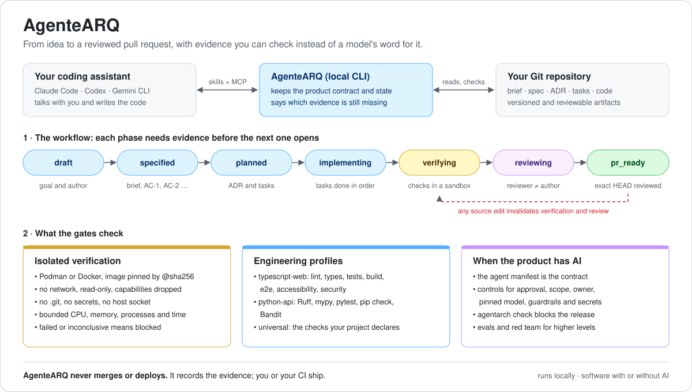

<p align="center">
  
</p>

<p align="center">
  <a href="LICENSE"></a>
  
  
</p>

# AgenteARQ

**Your AI coding assistant writes the code. AgenteARQ makes it prove it.**

Coding assistants are fast, and just as confident when they are wrong: a test that never ran, a
check that was quietly skipped, a "looks good" from the same agent that wrote the change.
AgenteARQ is an open-source CLI and plugin for **Claude Code, Codex and Gemini CLI** that turns
"it works" into evidence you can check, from the first idea to a reviewed pull request and a
release checked in production.

- **Nothing passes without evidence.** A missing, interrupted or inconclusive check blocks the work.
  It is never counted as a pass.
- **Checks run where they cannot cheat.** Each check runs in a container with no network, no
  secrets, no `.git` and a pinned image, against a copy of the code. Every profile also scans for
  committed secrets and known-vulnerable dependencies, and the project cannot switch that off.
- **No self-approval.** Review must come from someone other than the author, and it is tied to
  the exact commit. Change one line afterwards and the approval is gone.
- **Your assistant keeps the wheel.** AgenteARQ supplies the skills, the state and the gates. It
  never calls a model, needs no extra API key, and never merges or deploys.
- **Built for AI products too.** When the product itself has agents, 46 controls cover approval of
  risky tools, scope, owners, pinned models, guardrails and secrets.

> **Status: pre-release.** `spec/1.0` is not frozen yet. Feedback and issues are welcome.

## How it works

<p align="center">
  
</p>

The workflow moves through discovery, specification, architecture, tasks, implementation,
isolated verification, independent review and PR preparation, then release and a post-deploy
check. Each step leaves an artifact in your repository (`brief.md`, `spec.md`, an ADR,
`tasks.yaml`, `release.md`) or a record in the local workflow state, and the next step stays
closed until the evidence exists.

## Quick start

**1. Install the CLI** — pick one:

```bash
# Signed release binary (needs curl, tar and cosign; the installer refuses an unverified download)
curl -fsSL https://raw.githubusercontent.com/Everton-baptista/agenteARQ/v0.4.0/install.sh | sh

# With Go 1.22+
go install github.com/Everton-baptista/agenteARQ/cmd/agentarch@v0.4.0

# As a container
docker run --rm ghcr.io/everton-baptista/agentarch:v0.4.0 version
```

**2. In your project's Git repository** (Docker or Podman is needed for verification):

```bash
agentarch workflow init --name my-product --profile typescript-web \
  --goal "Describe the user outcome" --author "Your name"
agentarch plugin install claude --owner "Your name" --contact "you@example.com" \
  --model-provider anthropic --model "YOUR_EXACT_HOST_MODEL_ID"
agentarch ui        # optional: read-only progress dashboard
```

Then open the project in Claude Code and ask it to build what you described. Use `codex` or
`gemini` instead of `claude` for those hosts. `--model` records the model your host actually
uses; it cannot change or enforce it. `--dry-run` previews the installation, `plugin check`
reports drift and `plugin remove` removes only the files it manages.

## What is included

- **Product workflow plugin** — skills plus a local MCP server, for **Claude Code, Codex and
  Gemini CLI**. Other clients can use the reference package from `plugin install external`.
- **Verification profiles** — `typescript-web`, `python-api` and `go-service` with mandatory checks.
  Any other stack uses `universal`, where the project declares and reviews its own checks.
- **Security floor** — secret scanning (gitleaks) and an offline known-vulnerability audit
  (osv-scanner) in every profile, with scanner configuration the project cannot override.
- **Release evidence** — `record-release` and `record-production-check` record a deployment and its
  post-deploy check, refused unless the shipped content is exactly what was reviewed.
- **Architecture rules** — generated instruction files (`AGENTS.md`, `CLAUDE.md`, `GEMINI.md`,
  `QWEN.md`, Cursor, Copilot, Windsurf), so every assistant that reads them follows the same rules
  from a single source of truth, in any language.
- **Standard for AI agents** — 16 standards, 46 controls, 10 packs and 12 framework adapters.
- **Runnable blueprints** — 7 Python services with tests, evals, a Dockerfile and deploy guides;
  native Python runtimes and a LangGraph variant for RAG; Anthropic, OpenAI, Google and AWS Bedrock.
- **Two languages** — `en` and `pt-BR`, from the interview to every generated instruction file.

## Limits, stated plainly

- Verification needs an installed, digest-pinned Docker/Podman image with the project's tools.
  There is no unsandboxed fallback, and network is disabled while checks run.
- Review identity is recorded locally, not externally authenticated.
- Publishing the PR stays with your host; merge and deploy remain separate human decisions.
  AgenteARQ records a release and an attested production check; it does not observe production.
- Evidence is local engineering evidence, not a certification.

Read more: [the workflow and profiles](docs/workflow.md), [host installation and
boundaries](docs/plugins.md), [the comparative benchmark protocol](docs/benchmark.md) and
[implementation notes](docs/implementation.md). The standard for AI agents and its commands
are described below.

## The problem

Building a responsible AI agent today means assembling knowledge that lives in a dozen
disconnected places: the OWASP Top 10 for LLM Applications, MITRE ATLAS, NIST AI RMF,
ISO/IEC 42001, the OpenTelemetry GenAI semantic conventions, the prompt-injection literature,
MCP security advisories, and whatever your framework happens to call a "tool" or a "guardrail".

None of it is executable. So every team reinvents its own conventions, the knowledge lives in
one person's head, and nothing survives a change of framework, of assistant, or of team.

Meanwhile the AI assistant became the primary author of agent code — and it starts every
session with no memory of what your team decided. Instruction files (`AGENTS.md`, `CLAUDE.md`,
`.cursor/rules`) helped, but every tool reads a different file, all written by hand, all
drifting apart within weeks.

## What agentarch does

It answers three questions that have no standard answer today:

1. **What must be declared** for an agent to count as well-built — in machine-readable
   artifacts, not prose.
2. **How that is verified** automatically, in CI, without running the agent.
3. **How every AI assistant** picks up those rules from one source of truth.

## Getting started

### 1. Run it

One command. Nothing to install first:

```bash
mkdir my-agent && cd my-agent
go run github.com/Everton-baptista/agenteARQ/cmd/agentarch@latest
```

The first run compiles and takes half a minute; after that it is cached and instant. You need Go
1.22 or newer — the floor is deliberately low, so this does not quietly download a whole toolchain
before it starts.

It then asks at most three questions, all of them about the software, and derives the rest:

```
Language / Idioma

  1. English
  2. Português (Brasil)

Choose / Escolha 1–2 [1]:

agentarch — let's get you set up.

A few questions in plain language; nothing is written until you say so.
Press Enter to take the default, or q to quit.

Is this a new agent, or does the code already exist?

  1. New — start me off with a complete project that works, so I can edit it
  2. Already built — describe what is here and continue from it
  3. Already built — refactor it to the standard, with tests and review

(this directory looks empty)
Choose 1–3 [1]:

What are you building?

  1. A full agentic product — goal, tools, memory, approvals and observability
     agentic-product — runs on Python Native

  2. A chat on my website that answers customers, with a human approving the risky actions
     chatbot-web — runs on Python Native

  3. An agent that acts on my systems, with a human approving the dangerous part
     tool-approval — runs on Python Native

  4. An agent that answers from my documents and cites its sources
     rag-support — runs on Python Native, langgraph

  5. An agent that uses MCP servers I did not write
     mcp-consumer — runs on Python Native

  6. Expose my agent's tools so other agents and IDEs can call them safely
     mcp-server — runs on Python Native

  7. Several agents working together without losing track of who may do what
     multi-agent-handoff — runs on Python Native

Choose 1–7 (or q to quit):

Which model provider will it call?

  1. Anthropic (Claude)     claude-sonnet-4-5-20250929
  2. OpenAI (GPT)           gpt-5.6-terra
  3. Google (Gemini)        gemini-3.6-flash
  4. AWS Bedrock (Nova/Claude)  amazon.nova-micro-v1:0

All four are wired up already — the agent code is the same either way,
and only the manifest and one pinned SDK change. The model id is pinned
rather than left as an alias, so an upgrade is something you decide.

Choose 1–4 [1]:

Where are the people who will use it?

  1. Brazil                     brings the LGPD rules in
  2. Europe                     brings GDPR and the EU AI Act in
  3. Both
  4. Somewhere else             type the country code, e.g. US, IN, JP, NG
  5. Not decided yet
```

**The language question comes first, and it is the only one asked in both.** The answer reaches
every generated instruction file — `AGENTS.md`, `CLAUDE.md`, `GEMINI.md`, `QWEN.md`, Cursor,
Copilot and Windsurf — so an assistant working on a Portuguese team reads the rules in Portuguese.
Findings from the gate stay in English: translating those would put a translation obligation on
every new control, and a stale translation of a rule answers your question with authority using a
rule that has since changed.

Then it shows exactly what will happen, waits for a yes, and does all of it: installs the
standard, writes a complete working project, generates the instruction files every assistant
reads, writes your answers into the manifests, and runs `validate` and `check` so you can see
it passes before you touch anything.

You never type the words *profile*, *jurisdiction* or *blueprint*. It notices whether the
directory already has code, and only asks about a framework when the starting point you chose
ships more than one.

**The provider is a question rather than an assumption.** Every blueprint ships a seam —
`app/infra/provider.py`, with one module per provider behind it — so the answer changes three
things and nothing else: `model.provider` and a pinned `model.id` in the manifest, and one pinned
SDK in `app/requirements.txt`. The loop, the tools and the guardrails are identical either way,
which is the claim the blueprint's own tests check. Switching later is those same three files.

**It asks nothing about you, and reads nothing about you.** An earlier version asked who was
accountable and offered a default from `git config` — which put a work-provisioned identity into
two manifests in somebody's personal project, and then into a second tool's suggestion menu,
because a wrong value written by one tool is read as fact by the next. `owner.accountable` is now
an edit you make looking at the manifest, alongside `purpose` and `out_of_scope`.

It never overwrites a file that already exists, and nothing is written before you confirm.

What lands on disk:

```
agentarch/
  agentarch.yaml        your settings — never overwritten by an upgrade
  std/                  the standard itself — replaced wholesale by `upgrade`
  project/              your manifests, tool specs, evals — never touched by an upgrade
app/
  api/                  transport: routes, caller identity, redacted logging
  agent/                the loop, prompts, tools, guardrails — never imports api/
  domain/               your business rules. No LLM, no HTTP
  infra/                provider, secrets, storage, telemetry, resilience
  cli.py                the same agent with no server, which proves the layers hold
contracts/openapi.json  generated from the manifest, like .mcp.json from the allowlist
evals/run.py            the only thing that can write `status: measured`
.env.example            committed: names, never values
AGENTS.md               generated, read by Codex, Cursor, Gemini CLI, Grok, Kimi, Zed, Aider
CLAUDE.md               generated, read by Claude Code
GEMINI.md               generated, read by Gemini CLI
.github/workflows/      the gate, already wired
```

**Commit the generated instruction files.** They are outputs: edit `agentarch/std/core/` and
re-run `sync`. CI checks they are current, so a hand-edited `CLAUDE.md` fails the pull request
instead of drifting quietly for six months.

Everything `start` does is also available one command at a time — see
[the manual route](#the-manual-route) below. And in a script or CI, where there is nobody to ask:

```bash
agentarch start --new --blueprint rag-support --framework none \
  --provider bedrock --owner "Ana Silva" --jurisdictions BR --yes
```

**If the code already exists**, the third answer installs a refactoring workflow rather than a
project:

```bash
agentarch start --refactor --yes
```

agentarch does not rewrite your code — it installs the procedure and then checks the result. The
refactoring is done by you, or by whichever assistant reads the project: as a skill for Claude
Code, and as `agentarch/std/checklists/refactor.md` for Gemini CLI, Copilot, Cursor, Codex, Kimi,
Qwen Code, a local model, or by hand.

The procedure works in verifiable slices — a test for the current behaviour first, then the
change, then the gate — and the rule it exists to enforce is that behaviour and structure never
move in the same commit. `--adopt-baseline` records where you started and `--update-baseline`
closes what you fixed, so the debt disappears because it was paid rather than forgiven.

### 2. Install it, once you want it around

`go run …@latest` is for trying it. For daily use, pick one — every channel delivers the same
single static binary, so a Java or .NET project does not acquire a JavaScript or Python runtime
to validate its agents.

| | |
|---|---|
| `go install github.com/Everton-baptista/agenteARQ/cmd/agentarch@latest` | if you have Go |
| `curl -fsSL https://raw.githubusercontent.com/Everton-baptista/agenteARQ/main/install.sh \| sh` | if you do not |
| `docker run --rm -it -v "$PWD:/work" -w /work ghcr.io/everton-baptista/agentarch:latest start` | needs nothing but Docker |
| [Releases](https://github.com/Everton-baptista/agenteARQ/releases) | signed binaries, verified by hand |

The installer requires Cosign, verifies the Sigstore bundle for `checksums.txt` against the exact
release workflow and tag, then verifies the binary checksum. Missing or invalid signature bundles
are errors, including for old releases without the required bundle. It never uses `sudo` on your
behalf — without write access to `/usr/local/bin` it installs to `~/.local/bin` and tells you how
to add it.

<details>
<summary>Reading the installer first, and verifying a release by hand</summary>

Piping a script into a shell is a decision, not a default:

```bash
curl -fsSL https://raw.githubusercontent.com/Everton-baptista/agenteARQ/main/install.sh -o install.sh
less install.sh && sh install.sh
```

Or take a signed binary straight from Releases and check it yourself:

```bash
# Replace VERSION and the platform with an actual signed release.
VERSION=vX.Y.Z
gh release download "$VERSION" --repo Everton-baptista/agenteARQ \
  -p 'agentarch_*_darwin_arm64.tar.gz' -p 'checksums.txt' -p 'checksums.txt.sigstore.json'
cosign verify-blob checksums.txt --bundle checksums.txt.sigstore.json \
  --certificate-identity "https://github.com/Everton-baptista/agenteARQ/.github/workflows/release.yml@refs/tags/$VERSION" \
  --certificate-oidc-issuer https://token.actions.githubusercontent.com
shasum -a 256 -c checksums.txt --ignore-missing
```

The release workflow produces a keyless Cosign bundle. Verify the exact tag and workflow identity
before extraction; the checksum alone does not authenticate a download.

</details>

### 3. Run the agent

```bash
python -m venv .venv && source .venv/bin/activate
pip install -r app/requirements.txt
export AWS_BEARER_TOKEN_BEDROCK_API_KEY=...   # or ANTHROPIC_API_KEY, OPENAI_API_KEY, etc.

python -m app.cli "where is my order BR-77120?"
```

`app/README.md` explains what to read first and what to change. The short version: replace
`retrieve()` with your retriever, edit `out_of_scope` in the manifest, mirror it into the
prompt's refusal section, and replace the tools with yours.

Two blueprints go further. `chatbot-web` ships a chat page the service serves at
`http://localhost:8000/` — token field, message list, and the approval card rendered in the
browser when an action pauses for a human. `mcp-server` exposes the agent's tools over MCP
(`python -m app.mcp_server`), so other agents and IDEs can call them — advertised from the
reviewed specs, descriptions hashed against rug-pulls, and the irreversible tool still pausing
whoever calls it. Both serve the API and its Swagger console at `/docs` in development.

### 4. Check it

```bash
agentarch validate      # structure and internal consistency
agentarch check         # the release gate
agentarch conformance   # L1 / L2 / L3, with an expiry
```

Exit codes are distinct so CI can route them:

| Code | Means | What to do |
|---:|---|---|
| 0 | passed | — |
| 2 | an artifact is malformed or inconsistent | read the finding; it names the field |
| 3 | a generated file is out of date | run `agentarch sync` |
| 4 | a blocker-severity control failed | `agentarch explain <control.id>` |
| 5 | a waiver expired | it belongs to the person named on it |
| 6 | `diff --strict`: a revalidation trigger fired | re-run evals, update `last_validated_at` |

When something fails, `agentarch explain <control.id>` gives the reasoning, the fix, and which
pack imposed it.

### 5. Wire it into CI

```yaml
name: agentarch
on: [pull_request]
jobs:
  agentarch:
    runs-on: ubuntu-latest
    steps:
      - uses: actions/checkout@v4
      - uses: Everton-baptista/agenteARQ/.github/actions/agentarch@v0.3.0
        with:
          command: sync --check
      - uses: Everton-baptista/agenteARQ/.github/actions/agentarch@v0.3.0
        with:
          command: check --profile standard
```

The blueprints ship this file already, at `.github/workflows/agentarch.yml`.

---

## The manual route

`start` is a composition of commands that all exist on their own. Use them directly when you are
scripting, adding a second agent, or want to see each step:

```bash
agentarch init --profile standard --jurisdictions BR   # install the standard
agentarch blueprint list                              # what starting points exist
agentarch blueprint show rag-support                   # what one demonstrates
agentarch blueprint add rag-support --framework none --yes
agentarch sync                                        # regenerate the instruction files
```

`agentarch blueprint` with no arguments is the same chooser `start` uses, without the rest of the
interview. `--jurisdictions` decides which regulatory packs apply — `BR` brings LGPD, `EU` brings
GDPR and the AI Act; leave it out if none apply.

---

## Already have agents?

Do not start over, and do not switch the gate off on day one. `agentarch start` detects existing
code and offers this path by default; the explicit form is:

```bash
agentarch init --adopt --profile standard
```

It scans for what already exists — providers, models, frameworks, likely prompt files — and
writes a manifest describing it. **Everything it could not determine is left as `unknown`**, on
purpose: a plausible-looking wrong value is worse than a blank one, because nobody re-examines a
field that is already filled in.

Fill in the unknowns, starting with `owner.accountable` and `out_of_scope`. Then:

```bash
agentarch check --adopt-baseline
```

That records today's failures as the starting point. From then on the gate blocks only what is
**new or worse**. Nothing is forgiven — `agentarch score` still counts the debt, and you close it
deliberately:

```bash
agentarch check --update-baseline   # drops entries you have fixed
```

---

## The rest of the commands

| | |
|---|---|
| `agentarch start` | the guided entry point — asks, then does all of the below |
| `agentarch new agent <id>` | scaffold an empty agent instead of using a blueprint |
| `agentarch new tool <id> --effect irreversible` | scaffold a tool, with its approval block |
| `agentarch mcp audit --probe` | has a server changed its tool descriptions since review? |
| `agentarch diff --base main` | which revalidation triggers fired, and is validation overdue |
| `agentarch report --out reports/` | markdown and a self-contained HTML page |
| `agentarch workflow` | create, resume, verify and review a product workflow |
| `agentarch plugin` | install, inspect and remove managed host integrations |
| `agentarch mcp serve` | bounded workflow tools over stdio |
| `agentarch ui` | authenticated, read-only loopback dashboard |
| `agentarch score` | maturity by dimension, declared vs proven; never blocks |
| `agentarch aibom --out ai-bom.json` | models, prompts, corpora, tools, MCP servers |
| `agentarch upgrade --dry-run` | what a newer standard would change here |
| `agentarch pack list --installed` | which packs are judging this project |

Every command takes `--root` to work on a directory other than the current one, and
`agentarch --help --all` lists all of them with their flags. Plain `agentarch --help` shows only
the six you need in the first week.

## What it is not

Not a library. Not a runtime. It does not execute your agent and does not replace your
framework. It has to work the same in Python, TypeScript, Go, Java and .NET — so it stays out
of the execution path entirely.

---

## How it is organized

Four layers, versioned and licensed separately, so that this can be a standard rather than
just a tool:

| Layer | What it is | Version | License |
|---|---|---|---|
| **Spec** | normative contracts: schemas, control and pack format, resolution algorithm, exit codes, shim rendering | `spec/1.0` | CC BY 4.0 |
| **Content** | the standards, controls, official packs, templates, adapters | `content/1.x` | CC BY 4.0 |
| **Implementation** | `agentarch`, the reference CLI, written in Go | `cli/1.x` | Apache-2.0 |
| **Governance** | RFC process, conformance levels, versioning policy, registry | continuous | — |

`spec/conformance/` holds fixtures and expected outputs, so anyone can write a second
implementation — in Rust, in TypeScript, inside an internal platform — and prove it correct.

### Every rule exists twice

Once as **prose** you can read (`content/standards/`) and once as an **executable control**
(`content/packs/controls/`), sharing an identifier. `validate` checks the correspondence in
both directions: an undocumented control fails, and so does a documented rule that nothing
verifies.

That is the core defense against becoming shelfware: **prose without a verifiable consequence
does not get into the standard.** A rule that genuinely cannot be automated is admitted as
`check.kind: manual_attestation` — an honest declaration, not a loophole.

### Two things that are never negotiable

- **A pack is data, never code.** Checks are expressed in a restricted expression language
  specified in `spec/normative/04-expression-language.md` — no `eval`, no arbitrary calls. A
  governance standard that executes third-party code to verify governance does not hold up.
- **The core is a fixed budget, not a list.** What every assistant loads on every session is
  capped, and the build fails when it overflows. Adding an invariant means removing another —
  which makes "what is truly non-negotiable" a scarce, contested decision.

---

## What is in the box

| | |
|---|---|
| **Standards** | agent contract, prompt and context, tools, MCP, memory, multi-agent, human-in-the-loop, guardrails, security, privacy, evaluation, observability, resilience and cost, lifecycle, supply chain, service and edge |
| **Packs** | `core.agent`, `sec.owasp-llm`, `obs.otel`, `eval.baseline`, `api.edge`, `reg.gdpr`, `reg.br-lgpd`, `reg.eu-ai-act`, `std.nist-ai-rmf`, `std.iso-42001` |
| **Blueprints** | `agentic-product`, `chatbot-web`, `tool-approval`, `rag-support`, `mcp-consumer`, `mcp-server`, `multi-agent-handoff` — each a complete FastAPI service with Python Native as the default runtime, tests, evals, Dockerfile and deploy guides. `agentic-product` is the one that shows memory scoped to a tenant the caller cannot set; `chatbot-web` adds a browser chat UI; `mcp-server` exposes tools to other agents |
| **Adapters** | **Agno (ex-Phidata)** (documentation adapter), LangGraph, OpenAI Agents SDK, Claude Agent SDK, Google ADK, Pydantic AI, LlamaIndex, CrewAI, Semantic Kernel, Vercel AI SDK, FastAPI, and Python Native (Clean Architecture / Seam Pattern) |
| **Providers** | Anthropic (Claude), OpenAI (GPT), Google (Gemini), **AWS Bedrock** (Amazon Nova / Claude via Converse API) |
| **Generated for** | `AGENTS.md`, `CLAUDE.md`, `GEMINI.md`, `QWEN.md`, Cursor, Copilot, Windsurf, `.mcp.json` |

## Conformance

`agentarch conformance --badge` reports one of three levels:

| Level | Means |
|---|---|
| **L1 Declared** | agents are described: manifest, named owner, explicit out-of-scope, declared autonomy and budget |
| **L2 Enforced** | the rules block: gate in CI, guardrails at all three points, least-privilege tools, MCP allowlist denying by default |
| **L3 Proven** | there is evidence: evals within their freshness window, red team executed, threat model reviewed, OTel with pinned semconv, AI-BOM |

These are **local artifact assessments**, not certification or proof that a remote CI job ran.
Evidence labels alone never earn proven credit. A measured result must match current model, prompt,
corpus and dataset hashes and pass the authoritative plan thresholds.

The badge **expires**. An L3 badge whose evals went stale drops to L2 on its own. Conformance
that never decays is advertising.

---

## Regulation is optional and pluggable

Standards never cite law. Legal obligations live in optional versioned packs — `reg.eu-ai-act`,
`reg.gdpr`, `reg.br-lgpd`, `std.iso-42001`, `std.nist-ai-rmf` — each declaring its authority,
its `authority_status`, and its review date. Your agent declares `jurisdictions: ["EU", "BR"]`
and the applicable packs resolve automatically.

This is what lets a team in Berlin, São Paulo or Austin share the same core.

---

## Language

English is normative. Translations declare the SHA-256 of the source they were made from, and
`validate` flags them when they fall behind — a stale translation is worse than a missing one,
because it lies with authority. Control IDs, schema fields and file names stay in English in
every language, so error messages and searches remain interoperable across teams.

Shipping in v1: `en`, `pt-BR`.

---

## Contributing

New controls, severity changes, new sync targets, schema changes and new official packs go
through the RFC process in [`rfcs/`](rfcs/). See [CONTRIBUTING.md](CONTRIBUTING.md),
[GOVERNANCE.md](GOVERNANCE.md) and [CODE_OF_CONDUCT.md](CODE_OF_CONDUCT.md).

No control is ever born blocking. Controls enter with `enforced_from` one minor ahead and run
in warn mode until then, and no release makes an existing control stricter without a content
major.

## License

Code is Apache-2.0 ([LICENSE](LICENSE)). Spec and content are CC BY 4.0
([LICENSE-CONTENT](LICENSE-CONTENT)) so they can be quoted, translated and reimplemented.

The name is not covered by either — see [TRADEMARK.md](TRADEMARK.md). You may state a factual
claim of compliance without asking; you may not imply endorsement or name a product after it.
