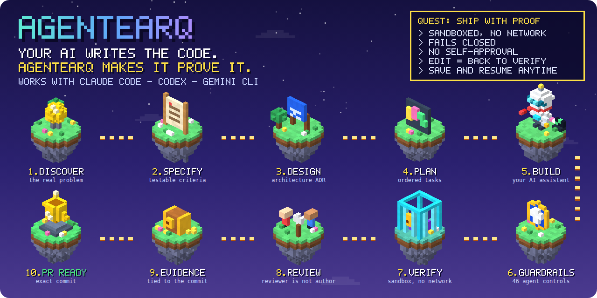

<p align="center">
  
</p>

<p align="center">
  <a href="LICENSE"></a>
  
  
</p>

# AgenteARQ

**Your AI coding assistant writes the code. AgenteARQ makes it prove it.**

Coding assistants are fast, and just as confident when they are wrong: a test that never ran, a
check that was quietly skipped, a "looks good" from the same agent that wrote the change.
AgenteARQ is an open-source CLI and plugin for **Claude Code, Codex and Gemini CLI** that takes
**any software product** — a website, an API, a mobile or desktop app, a CLI, documentation, a
data pipeline or an AI agent — from the first idea to a reviewed pull request and a release checked
in production, turning "it works" into evidence you can check.

- **Technology is your choice, never assumed.** AgenteARQ is not tied to a language, framework,
  host or vendor. It captures your constraints, and the architecture step must compare at least
  two options with their benefits and costs before you pick one; the ADR that records it is
  checked, not trusted.
- **Nothing passes without evidence.** A missing, interrupted or inconclusive check blocks the work.
  It is never counted as a pass.
- **Checks run where they cannot cheat.** Each check runs in a container with no network, no
  secrets, no `.git` and a pinned image, against a copy of the code. Every profile also scans for
  committed secrets and known-vulnerable dependencies, and the project cannot switch that off.
- **No self-approval.** Review must come from someone other than the author, and it is tied to
  the exact commit. Change one line afterwards and the approval is gone.
- **Your assistant keeps the wheel.** AgenteARQ supplies the skills, the state and the gates. It
  never calls a model, needs no extra API key, and never merges or deploys.
- **Built for AI products too.** When the product itself has agents, 46 controls cover approval of
  risky tools, scope, owners, pinned models, guardrails and secrets.

> **Status: pre-release.** `spec/1.0` is not frozen yet. Feedback and issues are welcome.

## How it works

<p align="center">
  
</p>

The workflow moves through discovery, specification, architecture, tasks, implementation,
isolated verification, independent review and PR preparation, then release and a post-deploy
check. Each step leaves an artifact in your repository (`brief.md`, `spec.md`, an ADR,
`tasks.yaml`, `release.md`) or a record in the local workflow state, and the next step stays
closed until the evidence exists.

## Quick start

**1. Install the CLI** — pick one:

```bash
# Signed release binary, no Go or sudo needed (curl and tar; the installer verifies the
# signature and checksum, fetching a pinned cosign if you have none, and refuses anything unverified)
curl -fsSL https://raw.githubusercontent.com/Everton-baptista/agenteARQ/v0.5.0/scripts/install.sh | sh

# With Go 1.22+
go install github.com/Everton-baptista/agenteARQ/cmd/agentarch@v0.5.0

# As a container
docker run --rm ghcr.io/everton-baptista/agentarch:v0.5.0 version

# Docker, but on your PATH: copy the binary out of the image (no Go, sudo or cosign download)
mkdir -p ~/.local/bin && id=$(docker create ghcr.io/everton-baptista/agentarch:v0.5.0) \
  && docker cp "$id":/agentarch ~/.local/bin/agentarch && docker rm "$id" >/dev/null
agentarch version    # if not found, add ~/.local/bin to your PATH
```

The installer downloads cosign (about 100 MB) when it is not already installed, so the first run
can take a few minutes on a slow link. Set `AGENTARCH_BIN_DIR=~/.local/bin` to choose where it
installs.

**2. In your project's Git repository** (Docker or Podman is needed for verification):

```bash
agentarch start     # asks what you are building and explains every choice it leaves to you
agentarch doctor    # what is still missing on this machine, and the exact fix for each item
```

or, without the interview:

```bash
agentarch workflow init --name my-product --profile <profile> \
  --goal "Describe the user outcome" --author "Your name"   # omit --profile to compare them
agentarch plugin install <claude|codex|gemini> --owner "Your name" --contact "you@example.com" \
  --model-provider <your-host-provider> --model "YOUR_EXACT_HOST_MODEL_ID"
agentarch ui        # optional: read-only progress dashboard
```

Then open the project in your assistant and ask it to start the product. It writes the brief with
you, proposes technology options with their trade-offs instead of picking one, and moves through
the steps. `--model` records the model your host actually
uses; it cannot change or enforce it. `--dry-run` previews the installation, `plugin check`
reports drift and `plugin remove` removes only the files it manages.

## What is included

- **Product workflow plugin** — skills plus a local MCP server, for **Claude Code, Codex and
  Gemini CLI**. Other clients can use the reference package from `plugin install external`.
- **Real-time guardrails in Claude Code** — install adds hooks that inject the product's current
  step at every session start, deny edits to generated files and workflow evidence, and ask the
  owner before any push, merge, publish or deploy command or secret-shaped content. A fresh-context,
  read-only reviewer subagent and a persona-user subagent come with it.
- **Plain-language refusals** — every workflow refusal says what it means and the next step, in
  English or Portuguese; `agentarch explain workflow.<id>` repeats it.
- **Scenarios, personas, design and owner acceptance** — acceptance criteria mapped to
  `scenarios.yaml`, optional `personas.yaml`, a design direction with DTCG tokens whose contrast
  and font licences are checked, and `workflow accept` for the owner's own verdict.
- **Verification profiles** — `typescript-web`, `python-api`, `go-service`, `static-site` (HTML, CSS
  and JavaScript with no build step) and `docs` (Markdown documentation), each with mandatory
  checks; `agentarch workflow init` lists them with what each verifies and lets you choose. Any
  other stack uses `universal`, where the project declares and reviews its own checks.
- **Security floor** — secret scanning (gitleaks) and an offline known-vulnerability audit
  (osv-scanner) in every profile, with scanner configuration the project cannot override.
- **Release evidence** — `record-release` and `record-production-check` record a deployment and its
  post-deploy check, refused unless the shipped content is exactly what was reviewed.
- **Architecture rules** — generated instruction files (`AGENTS.md`, `CLAUDE.md`, `GEMINI.md`,
  `QWEN.md`, Cursor, Copilot, Windsurf), so every assistant that reads them follows the same rules
  from a single source of truth, in any language.
- **Standards** — 17 standards (16 for AI agents, plus design quality for any interface), 46 controls, 10 packs and 12 framework adapters.
- **Runnable agent blueprints** — 7 Python AI-agent services with tests, evals, a Dockerfile and
  deploy guides. You choose the model provider (Anthropic, AWS Bedrock, Google or OpenAI) and the
  framework; none is preselected.
- **Two languages** — `en` and `pt-BR`, from the interview to every generated instruction file.

## Limits, stated plainly

- Verification needs an installed, digest-pinned Docker/Podman image with the project's tools.
  There is no unsandboxed fallback, and network is disabled while checks run.
- Review identity is recorded locally, not externally authenticated.
- Publishing the PR stays with your host; merge and deploy remain separate human decisions.
  AgenteARQ records a release and an attested production check; it does not observe production.
- Evidence is local engineering evidence, not a certification.

Read more: [the workflow and profiles](docs/workflow.md), [host installation and
boundaries](docs/plugins.md), [the comparative benchmark protocol](docs/benchmark.md) and
[implementation notes](docs/implementation.md). Building agents? The
[standard for AI agents](docs/agent-standard.md) covers manifests, the 46 controls, regulatory
packs and the CI gate. Everything else is indexed in [`docs/`](docs/README.md).

## Contributing

New controls, severity changes, new sync targets, schema changes and new official packs go
through the RFC process in [`docs/rfcs/`](docs/rfcs/). See [CONTRIBUTING.md](.github/CONTRIBUTING.md),
[GOVERNANCE.md](.github/GOVERNANCE.md) and [CODE_OF_CONDUCT.md](.github/CODE_OF_CONDUCT.md).

No control is ever born blocking. Controls enter with `enforced_from` one minor ahead and run
in warn mode until then, and no release makes an existing control stricter without a content
major.

## License

Code is Apache-2.0 ([LICENSE](LICENSE)). Spec and content are CC BY 4.0
([LICENSE-CONTENT](LICENSE-CONTENT)) so they can be quoted, translated and reimplemented.

The name is not covered by either — see [TRADEMARK.md](.github/TRADEMARK.md). You may state a factual
claim of compliance without asking; you may not imply endorsement or name a product after it.
